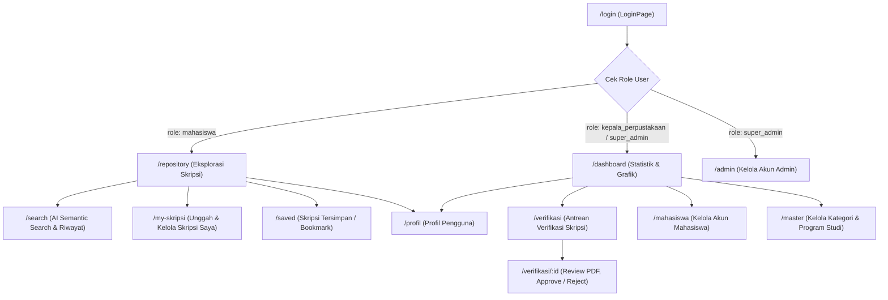

# DESIGN.md — Frontend React: Repository Perpustakaan Skripsi & AI Semantic Search

Dokumen ini dirancang khusus sebagai **System Prompt / Knowledge Base (Context File)** untuk **Vibe Coding** (menggunakan AI coding assistant seperti Antigravity, Cursor, Windsurf, v0, atau Bolt) dalam membangun antarmuka pengguna (UI) berbasis **React** yang terintegrasi penuh dengan backend Laravel REST API ini.

---

## 1. Gambaran Umum Proyek (Project Overview)

**Nama Aplikasi:** Sistem Repository Perpustakaan Skripsi (AI Semantic Search)  
**Deskripsi:** Platform repositori digital kampus untuk mengelola unggahan skripsi mahasiswa, verifikasi oleh Kepala Perpustakaan, serta pencarian skripsi cerdas menggunakan **AI Vector Embedding (Semantic Search)** dan pencarian katalog reguler.

### Peran Pengguna (User Roles)
Sistem menggunakan autentikasi **Bearer Token (Laravel Sanctum)** dengan 3 role utama:
1. **`mahasiswa`**:
   - Menjelajahi repositori skripsi yang telah disetujui (`disetujui`).
   - Mencari skripsi menggunakan **AI Semantic Search** (menampilkan skor kemiripan / *similarity*) dan mengelola riwayat pencarian.
   - Mengunggah, melihat, memperbarui, dan menghapus skripsi miliknya sendiri (`my-skripsi`) beserta file PDF skripsi dan ZIP/RAR source code.
   - Menyimpan (*bookmark*) skripsi ke daftar simpanan (`saved-skripsi`).
2. **`kepala_perpustakaan` (Admin)**:
   - Melihat dashboard analitik & statistik skripsi (total skripsi, total mahasiswa, ringkasan per status, dan grafik per tahun).
   - Memverifikasi skripsi yang berstatus `menunggu` (**Approve** otomatis memicu pembuatan Vector Embedding AI, atau **Reject** dengan catatan).
   - Mengelola akun **Mahasiswa** secara penuh (lihat daftar, tambah akun, edit akun, nonaktifkan/aktifkan kembali akun, dan hapus akun).
   - Mengelola data master **Kategori Skripsi** dan **Program Studi** (CRUD).
3. **`super_admin` (Super Admin)**:
   - Memiliki seluruh hak akses yang dimiliki oleh `kepala_perpustakaan`.
   - Memiliki hak eksklusif untuk mengelola akun **Admin (`kepala_perpustakaan`)**: melihat daftar admin, menambahkan akun admin baru, mengedit akun admin, menonaktifkan/mengaktifkan kembali akun admin, serta menghapus akun admin.

### Akun Default (Seeder Database)
| Role | Nama | Email | Password |
| :--- | :--- | :--- | :--- |
| **`super_admin`** | Super Administrator | `super.admin@universitas.ac.id` | `password` |
| **`kepala_perpustakaan`** | Dr. Ir. Budi Santoso, M.Kom. | `kepala.perpus@universitas.ac.id` | `password` |
| **`mahasiswa`** | Ahmad Fauzi | `ahmad.fauzi@mahasiswa.ac.id` | `password` |
| **`mahasiswa`** | Siti Nurhaliza | `siti.nurhaliza@mahasiswa.ac.id` | `password` |

---

## 2. Tech Stack & Arsitektur React yang Direkomendasikan

Gunakan stack berikut saat melakukan *vibe coding* agar komponen konsisten, cepat, dan mudah di-maintain:

- **Framework & Build Tool:** React 18/19 + Vite (TypeScript direkomendasikan)
- **Styling & UI Components:** Tailwind CSS + `shadcn/ui` + `lucide-react` (Icons)
- **Routing:** `react-router-dom` (v6/v7) dengan komponen `ProtectedRoute` dan `RoleRoute`
- **State Management & Data Fetching:**
  - Server State: `@tanstack/react-query` + `axios` (dengan interceptor `Authorization: Bearer <token>`)
  - Auth State: `zustand` atau React Context (`AuthContext` disimpan di `localStorage`)
- **Form & Validasi:** `react-hook-form` + `zod`
- **Visualisasi Data (Dashboard Kepala Perpustakaan):** `recharts`
- **Notifikasi Toast:** `sonner` atau `react-hot-toast`

### Struktur Direktori Frontend (`src/`)
```text
src/
├── api/
│   ├── axios.ts                # Instance Axios + Interceptor Bearer Token & Error 401
│   ├── auth.api.ts             # Login, Logout, Profil
│   ├── repository.api.ts       # Katalog publik/internal, Semantic Search, History, Saved
│   ├── mahasiswa.api.ts        # CRUD My Skripsi (Multipart Form-Data)
│   └── admin.api.ts            # Verifikasi, Statistik, Kelola Mahasiswa, Kelola Admin, Kategori, Prodi
├── components/
│   ├── layout/                 # AppShell, Sidebar, Topbar, RoleGuard
│   ├── skripsi/                # SkripsiCard, SkripsiFilterBar, StatusBadge, PdfPreviewModal
│   └── ui/                     # Shadcn UI primitives (Button, Dialog, Table, Badge, Input, dll)
├── context/
│   └── AuthContext.tsx         # Menyimpan user, role, token, login(), logout()
├── pages/
│   ├── auth/                   # LoginPage
│   ├── shared/                 # RepositoryListPage, RepositoryDetailPage, ProfilePage
│   ├── mahasiswa/              # SemanticSearchPage, MySkripsiPage, MySkripsiFormPage, SavedSkripsiPage
│   ├── kepala/                 # DashboardStatistikPage, VerifikasiListPage, VerifikasiDetailPage, KelolaMahasiswaPage, MasterDataPage
│   └── superadmin/             # KelolaAdminPage (Khusus role super_admin)
└── types/
    └── api.types.ts            # Interface TypeScript sesuai Resource Laravel
```

---

## 3. Design System & Panduan Visual (UI/UX Vibe)

- **Gaya Visual (Aesthetic):** *Modern Academic Clean* — bersih, profesional, fokus pada keterbacaan tipografi (seperti Google Scholar / Semantic Scholar / Notion).
- **Palet Warna (Tailwind):**
  - **Primary (Academic Indigo/Blue):** `indigo-600` (`#4F46E5`), hover `indigo-700` — melambangkan institusi akademik dan teknologi AI.
  - **Secondary / AI Accent (Violet/Emerald):** `violet-600` (`#7C3AED`) untuk fitur **AI Semantic Search** dan badge skor kemiripan (*Similarity Score*).
  - **Background:** `slate-50` (`#F8FAFC`) untuk latar halaman, `white` (`#FFFFFF`) untuk kartu/panel dengan border halus `slate-200`.
  - **Semantic Status Badges (`SkripsiStatus`):**
    - `menunggu`: Background `amber-50`, Text `amber-700`, Border `amber-200` (Ikon: `Clock`)
    - `disetujui`: Background `emerald-50`, Text `emerald-700`, Border `emerald-200` (Ikon: `CheckCircle2`)
    - `ditolak`: Background `rose-50`, Text `rose-700`, Border `rose-200` (Ikon: `XCircle`)
- **Tipografi:**
  - Heading & UI: `Inter` atau `Plus Jakarta Sans`
  - Abstrak Skripsi: `leading-relaxed` (`1.625`), ukuran `text-sm` atau `text-base` dengan warna `slate-700` agar nyaman dibaca panjang.
  - NIM / Kode Prodi / Ukuran File: `JetBrains Mono` (`font-mono`).

---

## 4. Alur Navigasi & Spesifikasi Halaman



### Detail Komponen Per Halaman

1. **Login Page (`/login`)**
   - Split-screen layout: Sisi kiri ilustrasi/branding perpustakaan kampus dengan highlight fitur AI Semantic Search; sisi kanan form login (`email`, `password`).
   - Setelah sukses login, simpan `token`, `role`, dan `user` dari `response.data.data`, lalu redirect otomatis sesuai `role`:
     - `mahasiswa` -> `/repository` atau `/search`
     - `kepala_perpustakaan` & `super_admin` -> `/dashboard`
   - Jika akun telah dinonaktifkan (`is_active: false`), tampilkan pesan error dari response `422` (`"Akun Anda telah dinonaktifkan. Silakan hubungi administrator."`).

2. **Eksplorasi Repository (`/repository` & `/repository/:id`) — *Semua Role Terautentikasi***
   - **List Page:** Search bar (`q`), filter dropdown **Kategori** (`GET /kategori`), **Program Studi** (`GET /program-studi`), dan **Tahun** (`tahun`). Menampilkan grid/list `SkripsiCard` + pagination.
   - **Detail Page:** Judul lengkap, penulis (Nama & NIM), Prodi, Kategori, Tahun, chip `kata_kunci` (split koma), teks `abstrak`, daftar file unduhan (`files` — PDF Skripsi & Source Code ZIP), serta tombol **Simpan / Hapus Simpanan** (khusus `mahasiswa`).

3. **AI Semantic Search (`/search`) — *Khusus Role `mahasiswa`***
   - Hero search box bertema AI dengan placeholder: *"Cari topik, metode, atau permasalahan skripsi dengan bahasa alami (min. 3 karakter)..."*
   - Panel **Riwayat Pencarian** (`GET /search-history`): Menampilkan chip kata kunci terakhir yang bisa diklik ulang, tombol hapus satuan (`DELETE /search-history/{id}`), dan tombol **Hapus Semua** (`DELETE /search-history/all`).
   - **Hasil Pencarian:** Menampilkan daftar `SkripsiCard` yang dilengkapi **Similarity Badge** (misal: `Kemiripan: ${(item.similarity * 100).toFixed(1)}%`).

4. **Skripsi Saya (`/my-skripsi`) — *Khusus Role `mahasiswa`***
   - Menampilkan daftar/status skripsi yang diunggah mahasiswa beserta badge status (`menunggu`, `disetujui`, `ditolak`).
   - **Form Modal / Halaman Unggah & Edit:**
     - Input: `judul`, `kategori_id` (Select), `tahun` (4 digit), `kata_kunci`, `abstrak` (Textarea).
     - Upload File Drag & Drop:
       - `file_skripsi`: Wajib saat buat baru, format `.pdf`, maks **20 MB**. (Opsional saat edit).
       - `file_source_code`: Opsional, format `.zip, .rar, .tar, .gz`, maks **50 MB**.

5. **Dashboard Statistik (`/dashboard`) — *Role `kepala_perpustakaan` & `super_admin`***
   - **4 KPI Cards:** Total Skripsi (`total_skripsi`), Total Mahasiswa (`total_mahasiswa`), Skripsi Disetujui (`per_status.disetujui`), Menunggu Verifikasi (`per_status.menunggu`).
   - **2 Grafik:**
     - Bar Chart / Area Chart jumlah skripsi disetujui per tahun (`per_tahun`).
     - Donut Chart proporsi status skripsi (`menunggu`, `disetujui`, `ditolak`).

6. **Verifikasi Skripsi (`/verifikasi` & `/verifikasi/:id`) — *Role `kepala_perpustakaan` & `super_admin`***
   - Tabel antrean skripsi berstatus `menunggu` dengan filter pencarian, kategori, prodi, dan tahun.
   - Halaman Detail Verifikasi: Pratinjau informasi skripsi + file lampiran, serta 2 tombol aksi utama:
     - **Setujui Skripsi (Approve):** Membuka dialog konfirmasi dengan input opsional `catatan` -> memanggil `POST /verifikasi/skripsi/{id}/approve`. *(Tampilkan loading state karena backend sekaligus men-generate AI Embedding).*
     - **Tolak Skripsi (Reject):** Membuka dialog dengan input `catatan` alasan penolakan -> memanggil `POST /verifikasi/skripsi/{id}/reject`.

7. **Kelola Akun Mahasiswa (`/mahasiswa`) — *Role `kepala_perpustakaan` & `super_admin`***
   - **Tabel Daftar Mahasiswa:** Menampilkan Nama, Email, NIM, Program Studi, Angkatan, Badge Status Akun (`Aktif` berwarna hijau `emerald` / `Nonaktif` berwarna abu-abu/merah `rose`), serta tombol aksi.
   - **Filter Bar:** Pencarian (`q` untuk nama/email/NIM), dropdown `program_studi_id`, `angkatan`, dan status akun (`is_active`).
   - **Modal Tambah & Edit Mahasiswa:**
     - Input: `name`, `email`, `password` (wajib saat tambah, opsional saat edit), `nim`, `program_studi_id` (Select dari `GET /program-studi`), `angkatan` (4 digit), dan toggle `is_active`.
   - **Aksi Baris Tabel:**
     - **Edit:** Membuka modal edit (`PUT /api/mahasiswa/{id}`).
     - **Nonaktifkan / Aktifkan Akun:** Memanggil `PATCH /api/mahasiswa/{id}/toggle-status` (otomatis mencabut token login mahasiswa jika dinonaktifkan).
     - **Hapus Akun:** Dialog konfirmasi hapus (`DELETE /api/mahasiswa/{id}`).

8. **Manajemen Master Data (`/master`) — *Role `kepala_perpustakaan` & `super_admin`***
   - Tab **Kategori Skripsi**: Tabel daftar kategori + Modal Tambah/Edit (`nama`, `slug` auto-generated dari nama) + Hapus.
   - Tab **Program Studi**: Tabel daftar prodi + Modal Tambah/Edit (`kode`, `nama`) + Hapus.

9. **Kelola Akun Admin (`/admin`) — *Khusus Role `super_admin`***
   - **Tabel Daftar Admin (`kepala_perpustakaan`):** Menampilkan Nama, Email, Role, Badge Status Akun (`Aktif` / `Nonaktif`), tanggal dibuat, serta tombol aksi.
   - **Filter Bar:** Pencarian (`q` untuk nama/email) dan filter status (`is_active`).
   - **Modal Tambah & Edit Admin:**
     - Input: `name`, `email`, `password` (wajib saat tambah, kosongkan jika tidak ingin mengubah password saat edit), serta toggle `is_active`.
   - **Aksi Baris Tabel:**
     - **Edit:** Membuka modal edit (`PUT /api/admin/{id}`).
     - **Nonaktifkan / Aktifkan Akun:** Memanggil `PATCH /api/admin/{id}/toggle-status` (langsung mencabut sesi/token admin yang sedang login apabila dinonaktifkan).
     - **Hapus Akun:** Dialog konfirmasi hapus (`DELETE /api/admin/{id}`).

---

## 5. Dokumentasi Lengkap REST API

### Konfigurasi Dasar
- **Base URL:** `http://localhost:8000/api` (sesuaikan dengan environment `VITE_API_BASE_URL`)
- **Headers Standar:**
  ```http
  Accept: application/json
  Content-Type: application/json
  Authorization: Bearer <token>
  ```
- **Headers Upload File (`/my-skripsi`):**
  ```http
  Accept: application/json
  Content-Type: multipart/form-data
  Authorization: Bearer <token>
  ```

> [!WARNING]
> **Catatan Penting Route Backend (`routes/api.php`):**
> 1. Endpoint **Logout** menggunakan method `GET /api/logout` (bukan `POST`).
> 2. Untuk **Update Skripsi (`PUT /api/my-skripsi/{id}`)** yang mengirim file (`multipart/form-data`), di Laravel gunakan method `POST` ke `/api/my-skripsi/{id}` dengan menambahkan field `_method: "PUT"` di dalam `FormData` agar file terbaca oleh PHP.

---

### A. Autentikasi & Profil

#### 1. Login
- **Endpoint:** `POST /api/login`
- **Akses:** Publik
- **Request Body (JSON):**
  ```json
  {
    "email": "mahasiswa@kampus.ac.id",
    "password": "password"
  }
  ```
- **Response `200 OK`:**
  ```json
  {
    "message": "login berhasil",
    "data": {
      "user": {
        "id": 1,
        "name": "Budi Santoso",
        "email": "mahasiswa@kampus.ac.id",
        "role": "mahasiswa",
        "is_active": true
      },
      "role": "mahasiswa",
      "token": "1|laravel_sanctum_plain_text_token..."
    }
  }
  ```
- **Response `422 Unprocessable Entity` (Kredensial Salah):**
  ```json
  {
    "message": "Email atau Password salah.",
    "errors": {
      "email": ["Email atau Password salah."]
    }
  }
  ```
- **Response `422 Unprocessable Entity` (Akun Dinonaktifkan):**
  ```json
  {
    "message": "Akun Anda telah dinonaktifkan. Silakan hubungi administrator.",
    "errors": {
      "email": ["Akun Anda telah dinonaktifkan. Silakan hubungi administrator."]
    }
  }
  ```

#### 2. Logout
- **Endpoint:** `GET /api/logout`
- **Akses:** `auth:sanctum`
- **Response `200 OK`:**
  ```json
  {
    "message": "Logout berhasil"
  }
  ```

#### 3. Detail Profil Pengguna
- **Endpoint:** `GET /api/profil`
- **Akses:** `auth:sanctum`
- **Response `200 OK` (`ProfilResource`):**
  ```json
  {
    "data": {
      "id": 1,
      "name": "Budi Santoso",
      "email": "mahasiswa@kampus.ac.id",
      "role": "mahasiswa",
      "is_active": true,
      "mahasiswa": {
        "id": 1,
        "nim": "202110370311",
        "angkatan": 2021,
        "program_studi_id": 1,
        "program_studi": "Teknik Informatika"
      },
      "created_at": "2026-01-01T00:00:00.000000Z",
      "updated_at": "2026-01-01T00:00:00.000000Z"
    }
  }
  ```
  *(Catatan: Jika user adalah `kepala_perpustakaan` atau `super_admin`, field `mahasiswa` tidak disertakan/bernilai `null`).*

---

### B. Data Master Publik & Admin (`Kategori` & `Program Studi`)

#### 1. Daftar Kategori
- **Endpoint:** `GET /api/kategori`
- **Akses:** Publik
- **Response `200 OK`:**
  ```json
  {
    "data": [
      {
        "id": 1,
        "nama": "Kecerdasan Buatan",
        "slug": "kecerdasan-buatan",
        "created_at": "2026-01-01T00:00:00.000000Z",
        "updated_at": "2026-01-01T00:00:00.000000Z"
      }
    ]
  }
  ```

#### 2. Tambah / Update / Hapus Kategori
- **Akses:** `auth:sanctum`, `role:kepala_perpustakaan,super_admin`
- **Tambah:** `POST /api/kategori`
- **Update:** `PUT /api/kategori/{id}`
- **Body (JSON):**
  ```json
  {
    "nama": "Rekayasa Perangkat Lunak",
    "slug": "rekayasa-perangkat-lunak"
  }
  ```
- **Hapus:** `DELETE /api/kategori/{id}`
- **Response `200 OK`:**
  ```json
  {
    "message": "kategori Berhasil dibuat"
  }
  ```

#### 3. Daftar Program Studi
- **Endpoint:** `GET /api/program-studi`
- **Akses:** Publik
- **Response `200 OK`:**
  ```json
  {
    "data": [
      {
        "id": 1,
        "kode": "TI",
        "nama": "Teknik Informatika",
        "created_at": "2026-01-01T00:00:00.000000Z",
        "updated_at": "2026-01-01T00:00:00.000000Z"
      }
    ]
  }
  ```

#### 4. Tambah / Update / Hapus Program Studi
- **Akses:** `auth:sanctum`, `role:kepala_perpustakaan,super_admin`
- **Tambah:** `POST /api/program-studi`
- **Update:** `PUT /api/program-studi/{id}`
- **Body (JSON):**
  ```json
  {
    "kode": "SI",
    "nama": "Sistem Informasi"
  }
  ```
- **Hapus:** `DELETE /api/program-studi/{id}`
- **Response `200 OK`:**
  ```json
  {
    "message": "Program Studi berhasil dibuat"
  }
  ```

---

### C. Repository Skripsi (Katalog Disetujui)

#### 1. Daftar Skripsi Disetujui
- **Endpoint:** `GET /api/repository/skripsi`
- **Akses:** `auth:sanctum` (Semua Role)
- **Query Parameters (Opsional):**
  - `q` (string): Kata kunci judul/abstrak/kata_kunci
  - `kategori_id` (number): Filter ID kategori
  - `program_studi_id` (number): Filter ID program studi
  - `tahun` (number): Filter tahun (contoh: `2025`)
  - `per_page` (number): Jumlah item per halaman
  - `page` (number): Nomor halaman
- **Response `200 OK` (`SkripsiResource` Collection + Pagination):**
  ```json
  {
    "data": [
      {
        "id": 10,
        "judul": "Implementasi Semantic Search Menggunakan Vector Embedding pada Repository Perpustakaan",
        "abstrak": "Penelitian ini membahas penerapan pencarian semantik...",
        "kata_kunci": "semantic search, vector embedding, nlp, skripsi",
        "tahun": 2026,
        "status": "disetujui",
        "di_upload": "2026-10-12T08:30:00.000000Z",
        "similarity": null,
        "program_studi": {
          "kode": "TI",
          "nama": "Teknik Informatika"
        },
        "kategori": {
          "nama": "Kecerdasan Buatan"
        },
        "mahasiswa": {
          "id": 3,
          "nama": "Budi Santoso",
          "nim": "202110370311"
        },
        "files": [
          {
            "id": 15,
            "jenis": "skripsi",
            "nama_file": "skripsi_full.pdf",
            "path": "skripsi/pdf/skripsi_full.pdf",
            "ukuran": 2048576
          }
        ]
      }
    ],
    "links": { "first": "...", "last": "...", "prev": null, "next": null },
    "meta": { "current_page": 1, "last_page": 1, "per_page": 15, "total": 1 }
  }
  ```

#### 2. Detail Skripsi Disetujui
- **Endpoint:** `GET /api/repository/skripsi/{id}`
- **Akses:** `auth:sanctum`
- **Response `200 OK`:** Object ` { "data": { ...SkripsiResource } }`.

---

### D. Fitur Mahasiswa (`role:mahasiswa`)

#### 1. Skripsi Saya (CRUD)
- **Daftar Skripsi Saya:** `GET /api/my-skripsi`
  - Response: `{ "data": [ ...SkripsiResource (termasuk field 'catatan') ] }`
- **Detail Skripsi Saya:** `GET /api/my-skripsi/{id}`
  - Response: `{ "data": { ...SkripsiResource, "catatan": "Catatan verifikasi dari kepala perpustakaan (atau null)" } }`
- **Unggah Skripsi Baru:** `POST /api/my-skripsi` *(Pastikan route di `routes/api.php` telah diperbaiki ke `POST`)*
  - **Content-Type:** `multipart/form-data`
  - **Form Fields:**
    | Field | Tipe | Wajib | Aturan Validasi |
    | :--- | :--- | :--- | :--- |
    | `kategori_id` | Integer | Ya | Harus ada di tabel `kategori` |
    | `judul` | String | Ya | Maks. 255 karakter |
    | `abstrak` | String | Ya | Teks abstrak lengkap |
    | `kata_kunci` | String | Ya | Maks. 255 karakter (pisahkan dengan koma) |
    | `tahun` | Integer | Ya | 4 digit angka (contoh: `2026`) |
    | `file_skripsi` | File | Ya | Format `pdf`, maks `20480` KB (20 MB) |
    | `file_source_code`| File | Tidak | Format `zip,rar,tar,gz`, maks `51200` KB (50 MB) |
- **Update Skripsi Saya:** `POST /api/my-skripsi/{id}` dengan `_method=PUT` (atau `PUT /api/my-skripsi/{id}`)
  - Sama seperti form unggah, namun `file_skripsi` bersifat **opsional** (`nullable`) jika tidak ingin mengganti file PDF lama.
- **Hapus Skripsi Saya:** `DELETE /api/my-skripsi/{id}`
  - Response `200 OK`: `{ "message": "Skripsi berhasil dihapus" }`

#### 2. AI Semantic Search & Riwayat Pencarian
- **Semantic Search:** `POST /api/search/semantic`
  - **Request Body (JSON):**
    ```json
    {
      "q": "sistem temu kembali informasi menggunakan deep learning"
    }
    ```
    *(Validasi: `q` wajib diisi, string, minimal 3 karakter).*
  - **Response `200 OK`:**
    ```json
    {
      "query": "sistem temu kembali informasi menggunakan deep learning",
      "data": [
        {
          "id": 10,
          "judul": "Implementasi Semantic Search...",
          "similarity": 0.8742,
          "status": "disetujui",
          "...": "..."
        }
      ]
    }
    ```
    *(Jika kosong, menyertakan `"message": "idak ditemukan skripsi yang relevan dengan pencarian Anda."`).*
- **Daftar Riwayat Pencarian:** `GET /api/search-history`
  - **Response `200 OK`:**
    ```json
    {
      "data": [
        {
          "id": 1,
          "query": "sistem temu kembali informasi",
          "created_at": "2026-11-07T01:20:00.000000Z"
        }
      ]
    }
    ```
- **Hapus Satu Riwayat:** `DELETE /api/search-history/{id}`
  - Response `200 OK`: `{ "message": "Riwayat pencarian berhasil dihapus" }`
- **Hapus Semua Riwayat:** `DELETE /api/search-history/all`
  - Response `200 OK`: `{ "message": "Riwayat pencarian berhasil dihapus" }`

#### 3. Simpanan / Bookmark Skripsi (`Saved Skripsi`)
- **Daftar Skripsi Tersimpan:** `GET /api/saved-skripsi`
- **Simpan Skripsi:** `POST /api/saved-skripsi/{skripsi_id}`
  - Response `201 Created`: `{ "message": "Skripsi berhasil disimpan" }`
- **Hapus dari Simpanan:** `DELETE /api/saved-skripsi/{skripsi_id}`
  - Response `200 OK`: `{ "message": "Skripsi berhasil dihapus dari simpanan" }`

---

### E. Fitur Kepala Perpustakaan & Super Admin (`role:kepala_perpustakaan,super_admin`)

#### 1. Statistik Dashboard
- **Endpoint:** `GET /api/statistik`
- **Response `200 OK`:**
  ```json
  {
    "data": {
      "total_skripsi": 120,
      "total_mahasiswa": 350,
      "per_status": {
        "menunggu": 15,
        "disetujui": 98,
        "ditolak": 7
      },
      "per_tahun": [
        { "tahun": 2026, "total": 45 },
        { "tahun": 2025, "total": 53 }
      ]
    }
  }
  ```

#### 2. Verifikasi Skripsi
- **Daftar Antrean Verifikasi (`menunggu`):** `GET /api/verifikasi/skripsi`
  - Query Params Opsional: `q`, `search`, `kategori_id`, `program_studi_id`, `tahun`, `per_page`, `page`.
  - Response: Koleksi `SkripsiResource` dengan pagination.
- **Detail Skripsi untuk Verifikasi:** `GET /api/verifikasi/skripsi/{id}`
  - Response: `{ "data": { ...SkripsiResource } }`.
- **Setujui Skripsi (Approve + Auto Generate AI Embedding):**
  - **Endpoint:** `POST /api/verifikasi/skripsi/{id}/approve`
  - **Request Body (JSON):**
    ```json
    {
      "catatan": "Dokumen lengkap dan format sesuai pedoman perpustakaan."
    }
    ```
  - **Response `200 OK`:** `{ "message": "Skripsi berhasil disetujui" }`
- **Tolak Skripsi (Reject):**
  - **Endpoint:** `POST /api/verifikasi/skripsi/{id}/reject`
  - **Request Body (JSON):**
    ```json
    {
      "catatan": "File PDF belum menyertakan lembar pengesahan bertanda tangan."
    }
    ```
  - **Response `200 OK`:** `{ "message": "Skripsi berhasil ditolak" }`

#### 3. Kelola Akun Mahasiswa (CRUD + Nonaktifkan/Aktifkan Akun)
*(Parameter `{id}` pada seluruh endpoint di bawah ini adalah **ID User (`users.id`)** dari akun mahasiswa).*

- **Daftar Semua Mahasiswa:** `GET /api/mahasiswa`
  - **Query Parameters (Opsional):**
    - `q` / `search` (string): Cari berdasarkan nama, email, atau NIM mahasiswa
    - `program_studi_id` (number): Filter berdasarkan ID program studi
    - `angkatan` (number): Filter tahun angkatan (contoh: `2021`)
    - `is_active` (boolean: `true` / `false` / `1` / `0`): Filter status aktif akun
    - `per_page` (number): Jumlah data per halaman (default: `15`)
    - `page` (number): Nomor halaman
  - **Response `200 OK`:** Koleksi `ProfilResource` dengan pagination (`data`, `links`, `meta`).

- **Detail Akun Mahasiswa:** `GET /api/mahasiswa/{id}`
  - **Response `200 OK`:** `{ "data": { ...ProfilResource } }`

- **Tambah Akun Mahasiswa Baru:** `POST /api/mahasiswa`
  - **Request Body (JSON):**
    ```json
    {
      "name": "Ahmad Fauzi",
      "email": "ahmad.fauzi@mahasiswa.ac.id",
      "password": "password123",
      "nim": "210101001",
      "program_studi_id": 1,
      "angkatan": 2021,
      "is_active": true
    }
    ```
  - **Aturan Validasi:**
    | Field | Tipe | Wajib | Aturan Validasi |
    | :--- | :--- | :--- | :--- |
    | `name` | String | Ya | Maks. 255 karakter |
    | `email` | String (Email) | Ya | Format email valid, unik di tabel `users` |
    | `password` | String | Ya | Minimal 8 karakter |
    | `nim` | String | Ya | Maks. 30 karakter, unik di tabel `mahasiswa` |
    | `program_studi_id` | Integer | Ya | Harus ada di tabel `program_studi` |
    | `angkatan` | Integer | Ya | 4 digit angka (contoh: `2021`) |
    | `is_active` | Boolean | Tidak | Default `true` |
  - **Response `201 Created`:**
    ```json
    {
      "message": "Akun mahasiswa berhasil ditambahkan",
      "data": {
        "id": 5,
        "name": "Ahmad Fauzi",
        "email": "ahmad.fauzi@mahasiswa.ac.id",
        "role": "mahasiswa",
        "is_active": true,
        "mahasiswa": {
          "id": 3,
          "nim": "210101001",
          "angkatan": 2021,
          "program_studi_id": 1,
          "program_studi": "Teknik Informatika"
        },
        "created_at": "2026-11-07T03:45:00.000000Z",
        "updated_at": "2026-11-07T03:45:00.000000Z"
      }
    }
    ```

- **Edit Akun Mahasiswa:** `PUT /api/mahasiswa/{id}`
  - **Request Body (JSON):**
    ```json
    {
      "name": "Ahmad Fauzi Updated",
      "email": "ahmad.fauzi@mahasiswa.ac.id",
      "password": "newpassword123",
      "nim": "210101001",
      "program_studi_id": 1,
      "angkatan": 2021,
      "is_active": true
    }
    ```
    *(Catatan: Field `password` bersifat opsional/`nullable` saat edit; kosongkan atau jangan kirim jika tidak ingin mengubah password).*
  - **Response `200 OK`:**
    ```json
    {
      "message": "Akun mahasiswa berhasil diperbarui",
      "data": { "...ProfilResource" }
    }
    ```

- **Nonaktifkan / Aktifkan Akun Mahasiswa:** `PATCH /api/mahasiswa/{id}/toggle-status`
  - **Request Body (JSON — Opsional):**
    ```json
    {
      "is_active": false
    }
    ```
    *(Catatan: Jika body `is_active` tidak dikirim, endpoint otomatis membalik status saat ini / toggle. Ketika akun dinonaktifkan, seluruh token login Sanctum milik mahasiswa tersebut langsung dicabut).*
  - **Response `200 OK`:**
    ```json
    {
      "message": "Akun mahasiswa berhasil dinonaktifkan",
      "data": {
        "id": 5,
        "name": "Ahmad Fauzi",
        "email": "ahmad.fauzi@mahasiswa.ac.id",
        "role": "mahasiswa",
        "is_active": false,
        "mahasiswa": {
          "id": 3,
          "nim": "210101001",
          "angkatan": 2021,
          "program_studi_id": 1,
          "program_studi": "Teknik Informatika"
        },
        "created_at": "2026-11-07T03:45:00.000000Z",
        "updated_at": "2026-11-07T03:50:00.000000Z"
      }
    }
    ```

- **Hapus Akun Mahasiswa:** `DELETE /api/mahasiswa/{id}`
  - **Response `200 OK`:**
    ```json
    {
      "message": "Akun mahasiswa berhasil dihapus"
    }
    ```

#### 4. Generate Ulang Embedding Manual (Utilitas)
- **Endpoint:** `POST /api/embeddings/{id}`
- **Response `200 OK`:** `{ "message": "Embedding berhasil dibuat", "data": { ... } }`
- **Response `400 Bad Request`:** `{ "message": "Skripsi belum disetujui" }`

---

### F. Fitur Khusus Super Admin (`role:super_admin`)

#### Kelola Akun Admin (`kepala_perpustakaan`)
Seluruh endpoint di bawah ini **hanya dapat diakses oleh pengguna dengan role `super_admin`**. Jika diakses oleh `kepala_perpustakaan` atau `mahasiswa`, API mengembalikan `403 Forbidden` (`{ "message": "Anda tidak memiliki akses." }`).

- **Daftar Semua Admin:** `GET /api/admin`
  - **Query Parameters (Opsional):**
    - `q` / `search` (string): Cari berdasarkan nama atau email admin
    - `is_active` (boolean: `true` / `false` / `1` / `0`): Filter status aktif akun
    - `per_page` (number): Jumlah item per halaman (default: `15`)
    - `page` (number): Nomor halaman
  - **Response `200 OK`:** Koleksi `ProfilResource` dengan pagination (`data`, `links`, `meta`).

- **Detail Akun Admin:** `GET /api/admin/{id}`
  - **Response `200 OK`:** `{ "data": { ...ProfilResource } }`

- **Tambah Akun Admin Baru:** `POST /api/admin`
  - **Request Body (JSON):**
    ```json
    {
      "name": "Dr. Hendra Wijaya, M.Kom.",
      "email": "hendra.perpus@universitas.ac.id",
      "password": "password123",
      "is_active": true
    }
    ```
  - **Aturan Validasi:**
    | Field | Tipe | Wajib | Aturan Validasi |
    | :--- | :--- | :--- | :--- |
    | `name` | String | Ya | Maks. 255 karakter |
    | `email` | String (Email) | Ya | Format email valid, unik di tabel `users` |
    | `password` | String | Ya | Minimal 8 karakter |
    | `is_active` | Boolean | Tidak | Default `true` |
  - **Response `201 Created`:**
    ```json
    {
      "message": "Akun admin berhasil ditambahkan",
      "data": {
        "id": 8,
        "name": "Dr. Hendra Wijaya, M.Kom.",
        "email": "hendra.perpus@universitas.ac.id",
        "role": "kepala_perpustakaan",
        "is_active": true,
        "created_at": "2026-11-07T04:00:00.000000Z",
        "updated_at": "2026-11-07T04:00:00.000000Z"
      }
    }
    ```

- **Edit Akun Admin:** `PUT /api/admin/{id}`
  - **Request Body (JSON):**
    ```json
    {
      "name": "Dr. Hendra Wijaya, S.Kom., M.Kom.",
      "email": "hendra.perpus@universitas.ac.id",
      "password": "newpassword123",
      "is_active": true
    }
    ```
    *(Catatan: `password` bersifat opsional/`nullable` saat edit).*
  - **Response `200 OK`:**
    ```json
    {
      "message": "Akun admin berhasil diperbarui",
      "data": { "...ProfilResource" }
    }
    ```

- **Nonaktifkan / Aktifkan Akun Admin:** `PATCH /api/admin/{id}/toggle-status`
  - **Request Body (JSON — Opsional):**
    ```json
    {
      "is_active": false
    }
    ```
    *(Catatan: Jika `is_active` tidak dikirim pada body, endpoint akan men-toggle status aktif saat ini. Saat akun admin dinonaktifkan, seluruh token login aktifnya langsung dihapus).*
  - **Response `200 OK`:**
    ```json
    {
      "message": "Akun admin berhasil dinonaktifkan",
      "data": {
        "id": 8,
        "name": "Dr. Hendra Wijaya, S.Kom., M.Kom.",
        "email": "hendra.perpus@universitas.ac.id",
        "role": "kepala_perpustakaan",
        "is_active": false,
        "created_at": "2026-11-07T04:00:00.000000Z",
        "updated_at": "2026-11-07T04:05:00.000000Z"
      }
    }
    ```

- **Hapus Akun Admin:** `DELETE /api/admin/{id}`
  - **Response `200 OK`:**
    ```json
    {
      "message": "Akun admin berhasil dihapus"
    }
    ```

---

## 6. Panduan Prompt Vibe Coding (Siap Copy-Paste)

Gunakan urutan prompt di bawah ini saat melakukan *vibe coding* agar aplikasi React terbangun secara bertahap dan bebas error:

### Tahap 1: Setup Fondasi, Auth & Layout Role-Based
> *"Berdasarkan file `DESIGN.md`, buatkan fondasi proyek React + TypeScript + Tailwind CSS + React Router. Buat `api.types.ts` sesuai seluruh response JSON di `DESIGN.md` (termasuk role `mahasiswa`, `kepala_perpustakaan`, dan `super_admin` serta status `is_active`), instance Axios dengan Bearer token interceptor, `AuthContext` untuk mengelola login (`POST /api/login`) dan logout (`GET /api/logout`), serta `AppShell` dengan Sidebar dinamis yang menyesuaikan menu untuk role `mahasiswa`, `kepala_perpustakaan`, dan `super_admin`."*

### Tahap 2: Katalog Repository & AI Semantic Search (Mahasiswa)
> *"Berdasarkan `DESIGN.md`, buatkan halaman Eksplorasi Repository (`/repository` dan `/repository/:id`) dengan fitur filter Kategori (`GET /api/kategori`), Program Studi (`GET /api/program-studi`), dan Tahun. Selanjutnya buatkan halaman AI Semantic Search (`/search`) untuk mahasiswa yang terhubung ke `POST /api/search/semantic`, lengkap dengan badge persentase similarity score, fitur bookmark (`POST/DELETE /api/saved-skripsi/{id}`), dan komponen Riwayat Pencarian (`GET/DELETE /api/search-history`)."*

### Tahap 3: Manajemen Skripsi Saya & Upload File (Mahasiswa)
> *"Berdasarkan `DESIGN.md`, buatkan halaman `/my-skripsi` untuk mahasiswa yang menampilkan daftar skripsi miliknya beserta status badge (`menunggu`, `disetujui`, `ditolak`). Buat form modal/halaman tambah & edit skripsi menggunakan `FormData` (`multipart/form-data`) dengan validasi PDF maks 20MB dan Source Code ZIP/RAR maks 50MB. Gunakan `_method: PUT` saat mengupdate data ke `/api/my-skripsi/{id}`."*

### Tahap 4: Dashboard Statistik, Verifikasi, Kelola Mahasiswa & Master Data (Admin & Super Admin)
> *"Berdasarkan `DESIGN.md`, buatkan fitur untuk role `kepala_perpustakaan` dan `super_admin`: (1) Halaman `/dashboard` yang memvisualisasikan `GET /api/statistik` menggunakan Recharts, (2) Halaman `/verifikasi` dan `/verifikasi/:id` untuk meninjau detail skripsi yang menunggu serta modal aksi Approve (`POST /api/verifikasi/skripsi/{id}/approve`) dan Reject (`POST /api/verifikasi/skripsi/{id}/reject`) dengan catatan, (3) Halaman `/mahasiswa` untuk CRUD akun mahasiswa (`GET/POST/PUT/DELETE /api/mahasiswa` dan `PATCH /api/mahasiswa/{id}/toggle-status` untuk nonaktifkan/aktifkan akun), serta (4) Halaman `/master` untuk CRUD Kategori dan Program Studi."*

### Tahap 5: Manajemen Akun Admin (Khusus Super Admin)
> *"Berdasarkan `DESIGN.md`, buatkan halaman `/admin` yang diproteksi khusus untuk role `super_admin`. Halaman ini menampilkan tabel daftar admin (`kepala_perpustakaan`) dari `GET /api/admin` lengkap dengan fitur pencarian, filter status aktif, modal Tambah Admin (`POST /api/admin`), modal Edit Admin (`PUT /api/admin/{id}`), tombol Nonaktifkan/Aktifkan Akun (`PATCH /api/admin/{id}/toggle-status`), serta konfirmasi Hapus Akun Admin (`DELETE /api/admin/{id}`)."*
